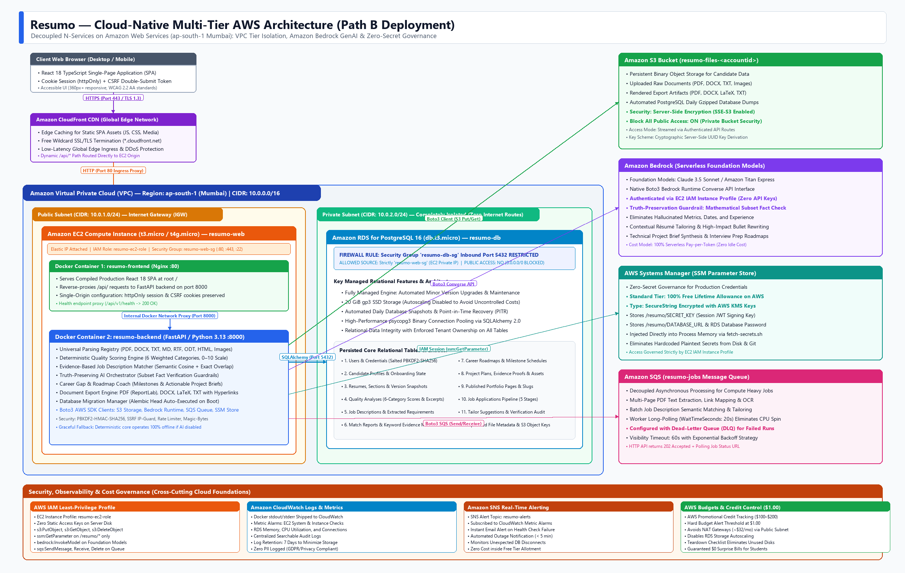
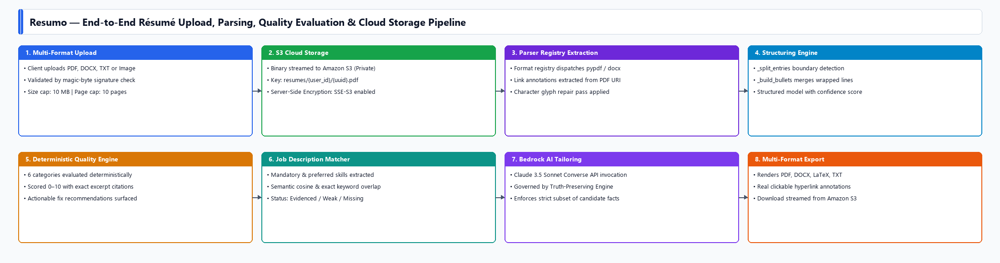
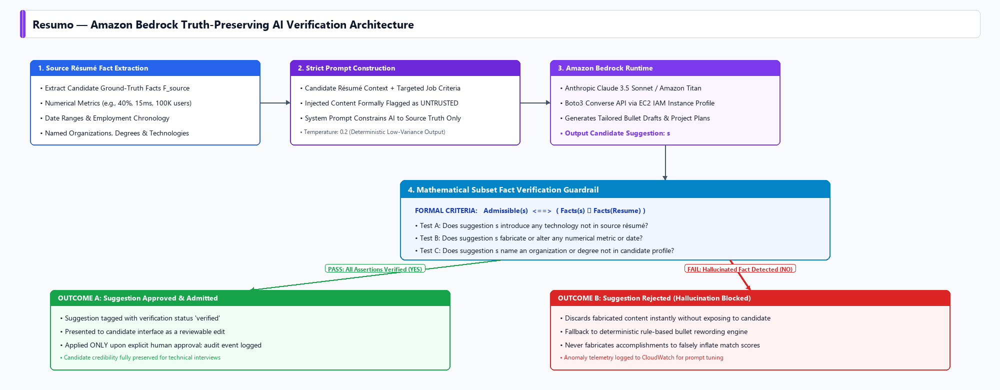

# Resumo: A Cloud-Native AI Resume Intelligence and Career-Preparation Platform on AWS

%CENTER%
A Mini-Project Report Submitted
For
Partial Fulfilment of the Requirements of the
Degree of Bachelor of Engineering
In
COMPUTER ENGINEERING
(Semester IV)
By
<<Group Members Name with Roll No>>
Under the guidance of
<<Project Guide's Name>>
2025-2026
%ENDCENTER%

%PAGE%

%CENTER%

This work is dedicated to our families and mentors.
We are deeply grateful for their continued motivation, guidance, and support.
%ENDCENTER%

%PAGE%

# Certificate

%CENTER%
This is to certify that the mini-project entitled "Resumo: A Cloud-Native AI Resume Intelligence and Career-Preparation Platform on AWS" is a bonafide work of "<<Students Name with Roll No>>" submitted to the University of Mumbai in partial fulfillment of the requirement for the award of the degree of Bachelor of Engineering in Computer Engineering (Semester-IV).
%ENDCENTER%

<<Name and Sign>>
Guide / Supervisor

%CENTER%
Dr. Sujata Deshmukh
HOD, Computer Dept.

Dr. S. S. Rathod
Principal
%ENDCENTER%

%PAGE%

# Approval Sheet

%CENTER%
Mini Project Report Approval for S.E. (Semester-IV)
%ENDCENTER%

This mini-project report entitled "Resumo: A Cloud-Native AI Resume Intelligence and Career-Preparation Platform on AWS" submitted by <<Add Student names and Roll Nos>> is approved for the degree of Bachelor of Engineering in Computer Engineering (Semester-IV).

Examiner 1. ______________________

Examiner 2. ______________________

Date:

Place: Mumbai

%PAGE%

# Declaration

We declare that this written submission represents our ideas in our own words and where others' ideas or words have been included, we have adequately cited and referenced the original sources. We also declare that we have adhered to all principles of academic honesty and integrity and have not misrepresented or fabricated or falsified any idea/data/fact/source in our submission. We understand that any violation of the above will be cause for disciplinary action by the Institute and can also evoke penal action from the sources which have thus not been properly cited or from whom proper permission has not been taken when needed.

<<Add Student Name 1, Roll No and Sign>>

<<Add Student Name 2, Roll No and Sign>>

<<Add Student Name 3, Roll No and Sign>>

<<Add Student Name 4, Roll No and Sign>>

%PAGE%

# Abstract

Modern engineering candidates encounter significant barriers during recruitment due to fragmented tools, opaque Applicant Tracking Systems (ATS), and unverified generative artificial intelligence that fabricates accomplishments. Simultaneously, building and deploying web applications that are resilient, scalable, secure, and cost-governed requires leveraging modern Cloud Computing architectures and managed services rather than brittle on-premise servers. This project presents Resumo, a cloud-native résumé intelligence and career-preparation platform engineered on Amazon Web Services (AWS) using an N-tier managed services methodology (Path B deployment). Resumo unifies résumé ingestion, deterministic quality evaluation, job-description alignment scoring, career roadmap discovery, and verifiable asset generation into a single secure workspace.

The cloud architecture is built upon AWS to ensure high availability, tier separation, and operational security. Application compute is hosted on an Amazon EC2 instance orchestrating containerized FastAPI backend and Nginx frontend services. Relational state is decoupled into an Amazon RDS PostgreSQL 16 database located within an isolated private Virtual Private Cloud (VPC) subnet, preventing direct public internet exposure. Uploaded documents, structured caches, and generated exports are persisted in a private Amazon S3 bucket featuring Server-Side Encryption (SSE-S3) and server-side key derivation. Global content delivery and edge Transport Layer Security (TLS) are managed by Amazon CloudFront. Generative intelligence is delivered serverless via Amazon Bedrock (Anthropic Claude 3.5 Sonnet / Amazon Titan), governed by a custom truth-preservation engine that rejects hallucinated facts, dates, and metrics. Heavy tasks are decoupled via Amazon SQS asynchronous messaging. Secrets are managed with zero disk footprint using AWS Systems Manager (SSM) Parameter Store with AWS KMS encryption, and least-privilege access is enforced through IAM instance profiles. Telemetry and cost ceilings are governed through Amazon CloudWatch and AWS Budgets within Free Tier and promotional credit allocations. The system was validated against authentic professional technical résumés and 46 automated integration tests, delivering a production-grade, sustainable cloud computing reference implementation.

**Keywords:** Cloud Computing, Amazon Web Services (AWS), Amazon Bedrock, Amazon RDS, Amazon S3, Amazon CloudFront, N-Tier Architecture, FastAPI, Docker, Applicant Tracking Systems, Truth-Preserving AI.

%PAGE%

# Acknowledgments

We have great pleasure in presenting the report on "Resumo: A Cloud-Native AI Resume Intelligence and Career-Preparation Platform on AWS". We take this opportunity to express our sincere thanks towards our guide, <<Project Guide's Name>>, C.R.C.E., Bandra (W), Mumbai, for providing technical guidelines, architectural recommendations, and suggestions regarding cloud deployment on Amazon Web Services. We thoroughly enjoyed discussing our technical milestones during our department laboratory sessions.

We express our heartfelt gratitude to Dr. Sujata Deshmukh, Head of the Computer Engineering department, the Principal, and the management of C.R.C.E., Mumbai, for their continuous encouragement and for providing the necessary computing infrastructure and laboratory facilities.

We also thank all faculty members and non-teaching staff of the Computer Engineering department for their kind assistance and technical support throughout this project.

Date:

Student Name 1 (Roll No.)

Student Name 2 (Roll No.)

Student Name 3 (Roll No.)

%PAGE%

# Table of Contents

| Chapter No | Topic | Page No. |
| --- | --- | --- |
|  | Abstract | v |
| 1 | Introduction | 1 |
| 1.1 | Background of the problem | 1 |
| 1.2 | Review of Literature | 2 |
| 1.3 | Problem Statement | 3 |
| 1.4 | Objectives of the Project | 3 |
| 1.5 | Scope of the Project | 4 |
| 2 | Sustainable Development Goals Mapping | 5 |
| 2.1 | Primary SDG | 5 |
| 2.2 | Additional SDGs | 5 |
| 2.3 | SDG Mapping | 5 |
| 3 | System Design | 7 |
| 3.1 | Block Diagram (AWS Cloud Architecture) | 7 |
| 3.2 | Module Description | 8 |
| 3.3 | Algorithms Used | 10 |
| 3.4 | Hardware and Software Requirements | 12 |
| 3.5 | Database | 13 |
| 4 | Implementation | 15 |
| 5 | Results | 19 |
| 5.1 | Key Outcomes of the Project | 19 |
| 5.2 | Comparison | 20 |
| 5.3 | Challenges Faced and Strategies to Overcome | 21 |
| 5.4 | Observations and Impact Analysis | 22 |
| 6 | Conclusion and Future Scope | 24 |
| 6.1 | Project Summary | 24 |
| 6.2 | Limitations and Areas for Improvement | 24 |
| 6.3 | Future Enhancements and Scalability | 24 |
|  | References | 26 |
|  | Appendix I: Datasets, Surveys | 27 |
|  | Appendix II: Field Trip Report | 27 |
|  | Appendix III: Certificates of Participation | 27 |
|  | Appendix IV: Concept Map | 28 |
|  | Appendix V: Plagiarism Report | 28 |

%PAGE%

# List of Tables

| Table No. | Table Name | Page No. |
| --- | --- | --- |
| 1.1 | Review of literature (comparison of cloud architectures and resume tools) | 2 |
| 2.1 | Sustainable Development Goals mapped to Resumo Cloud Platform | 6 |
| 3.1 | Module description and AWS Cloud service mapping | 9 |
| 3.2 | Hardware and AWS cloud infrastructure requirements | 12 |
| 3.3 | Software and cloud runtime requirements | 13 |
| 3.4 | Core database entities and cloud storage mapping | 14 |
| 5.1 | Automated test results and cloud readiness validation | 19 |
| 5.2 | Resume parsing results on representative professional technical resumes | 20 |
| 5.3 | Comparison of Resumo with existing systems and cloud deployment models | 21 |
| 5.4 | Key challenges and mitigation strategies (application and cloud) | 22 |

# List of Figures

| Figure No. | Figure Name | Page No. |
| --- | --- | --- |
| 3.1 | High-level multi-tier AWS cloud architecture (Path B deployment) | 7 |
| 3.2 | Résumé upload, parsing, and cloud storage pipeline | 8 |
| 3.3 | Amazon Bedrock truth-preserving AI inference pipeline | 11 |
| 4.1 | Deterministic quality scoring and rule evaluation flow | 16 |
| 4.2 | Job matching and evidence mapping flow | 17 |
| 4.3 | Multi-format export pipeline (S3 persistence and document rendering) | 18 |

%PAGE%

# Chapter 1: Introduction

## 1.1 Background of the problem

Cloud computing has transformed modern software engineering by replacing static on-premise servers with dynamic, distributed, and managed cloud infrastructure. In enterprise environments, applications must be architected for high availability, security isolation, elasticity, and cost efficiency. The National Institute of Standards and Technology (NIST) defines cloud computing through five essential characteristics: on-demand self-service, broad network access, resource pooling, rapid elasticity, and measured service [1]. Modern applications achieve these goals by transitioning from monolithic deployments on a single physical host to multi-tier cloud architectures composed of specialized managed services: managed relational databases (PaaS), scalable object storage (IaaS), Content Delivery Networks (CDNs), serverless artificial intelligence runtimes, asynchronous message queues, and granular Identity and Access Management (IAM).

Simultaneously, engineering students and early-career job seekers face acute challenges when transitioning into the technical workforce. Automated Applicant Tracking Systems (ATS) filter and rank résumés before technical recruiters evaluate them [2], [3]. Formatting anomalies, layout ambiguities, and missing keyword evidence cause qualified candidates to be silently rejected. Existing commercial tools address this ecosystem in a fragmented manner: résumé checkers score formatting, job boards provide generic search, and tailoring tools compute surface-level keyword overlap without validating whether candidates have genuine evidence for their claims.

Furthermore, the recent proliferation of unconstrained generative artificial intelligence has exacerbated the trust problem. Generic Large Language Model (LLM) wrappers frequently fabricate work experience, invent dates, and hallucinate performance metrics. When candidates present these fabricated claims during technical interviews, their credibility is compromised. Candidates need a unified, transparent workspace where every score is explainable, every skill gap is linked to actionable learning projects, and every AI-generated suggestion is provably grounded in verified facts.

Architecting such a system requires bridging domain-specific intelligence with robust cloud engineering. Handling multi-format file uploads, executing compute-intensive parsing, evaluating deterministic heuristics, and invoking foundational AI models cannot be executed reliably on an unmanaged local computer. By employing Amazon Web Services (AWS) with an N-tier managed services methodology (Path B), the application separates web presentation, business logic execution, relational data storage, binary document persistence, serverless AI inference, and secret governance into purpose-built cloud services.

## 1.2 Review of Literature

A comprehensive literature and market review was conducted across cloud infrastructure patterns, Applicant Tracking Systems, and generative AI platforms. The findings are summarized in Table 1.1.

| Ref | Source / Architecture | Category | Key documented capability | Architectural limitation / Resumo opportunity |
| --- | --- | --- | --- | --- |
| [4] | AWS Well-Architected Framework | Cloud Architecture | Five pillars: Operational Excellence, Security, Reliability, Performance, Cost Optimization | Reference architecture; requires deliberate implementation across VPC, IAM, and managed services |
| [5] | Amazon Bedrock Architecture | Cloud Generative AI | Serverless foundation model API with unified interface, IAM governance, and Guardrails | Requires application-level truth grounding to eliminate domain hallucinations |
| [6] | Jobscan ATS Matcher | Proprietary ATS Tool | Keyword match-rate percentage against pasted job description | Proprietary black-box score; no evidence provenance; lacks gap-to-project learning roadmaps |
| [7] | Teal Career Platform | Career CRM | Résumé builder, tracker, and surface-level tailoring | Workflow-first tool; lacks deterministic ATS diagnostic scoring and verifiable project briefs |
| [8] | Resume Worded | Feedback Service | Line-by-line AI phrasing suggestions and category feedback | Feedback is repetitive; no relational tracking; no cloud-native multi-tier decoupling |
| [9] | Rezi ATS Builder | Résumé Builder | Real-time ATS formatting feedback and bullet generator | Focused purely on document creation; no company research synthesis or skill roadmap |
| [10] | NIST SP 800-145 | Cloud Standards | Baseline definition of cloud service models (IaaS, PaaS, SaaS) and deployment methods | Standards document; establishes requirements for multi-tier isolation and measured billing |
| [11] | OWASP Top 10 (2021) | Cloud & Web Security | Taxonomy of web vulnerabilities: broken access control, SSRF, cryptographic failures | Must be mitigated through IAM instance roles, SSM Parameter Store, and SSRF URL filters |
| [12] | WCAG 2.2 Guidelines | Accessibility | Standards for perceivable, operable, and robust web user interfaces | UI design standard; essential for inclusive candidate onboarding |

The review reveals that while commercial tools provide isolated features, none combine an explainable, truth-preserving career guidance platform with a fully documented, multi-tier cloud infrastructure deployment on AWS.

**Table 1.1 Review of literature (comparison of cloud architectures and resume tools)**

## 1.3 Problem Statement

Engineering candidates lack a unified, trustworthy career-preparation workspace that accurately parses technical résumés, identifies concrete gaps against targeted job descriptions, and generates verified project roadmaps without hallucinating claims. Concurrently, deploying such data-intensive platforms on unmanaged or monolithic infrastructure introduces vulnerabilities, single points of failure, scaling bottlenecks, and secret leakage risks. The objective is to design, implement, and deploy Resumo: a full-stack, cloud-native application on Amazon Web Services utilizing an N-services managed architecture (Amazon EC2, Amazon RDS, Amazon S3, Amazon CloudFront, Amazon Bedrock, Amazon SQS, AWS IAM, and AWS SSM) that guarantees deterministic explainability, zero hardcoded credentials, least-privilege security, and strict cost governance within AWS Free Tier limits.

## 1.4 Objectives of the Project

1. **Cloud-Native N-Tier Architecture:** To design and deploy a decoupled multi-tier cloud topology on AWS separating the web/API tier (Amazon EC2), database tier (Amazon RDS PostgreSQL 16), object storage tier (Amazon S3), CDN tier (Amazon CloudFront), AI inference tier (Amazon Bedrock), and messaging tier (Amazon SQS).
2. **Universal Document Ingestion Pipeline:** To build a format-agnostic parsing registry supporting PDF, DOCX, TXT, Markdown, RTF, ODT, LaTeX, HTML, and images, converting unstructured candidate data into a normalized schema with recorded extraction confidence.
3. **Deterministic Quality Engine:** To implement an explainable, rule-based scoring engine evaluating six weighted categories (contact completeness, section balance, bullet quality, chronological integrity, ATS formatting safety, and evidence backing) scored out of 10 with exact excerpt citations.
4. **Evidence-Based Job Matching:** To parse job descriptions into required and preferred competencies, classifying candidate qualifications into *evidenced*, *weakly evidenced*, or *missing* status with cosine semantic and exact keyword signals.
5. **Serverless AI Integration via Amazon Bedrock:** To integrate Amazon Bedrock Foundation Models (Anthropic Claude 3.5 Sonnet / Amazon Titan) via `boto3` and the Converse API for intelligent suggestions, authenticated seamlessly through IAM instance roles without external API keys.
6. **Truth-Preserving Guardrails:** To implement an algorithmic fact-verification engine that enforces a strict subset relationship between candidate facts and AI suggestions, eliminating hallucinated metrics, dates, and technologies.
7. **Cloud Security & Zero-Secret Governance:** To enforce least-privilege AWS IAM instance profiles, restrict database access strictly to the EC2 security group, encrypt S3 objects using SSE-S3, and retrieve sensitive credentials at runtime from AWS SSM Parameter Store using KMS encryption.
8. **Decoupled Asynchronous Processing:** To architect asynchronous job queues using Amazon SQS for compute-intensive document extraction, scoring, and batch tailoring.
9. **Automated Document Export:** To generate production-ready PDF, DOCX, LaTeX, and plain-text documents containing genuine hyperlink annotations and ATS-compliant single-column layouts.
10. **Cost Governance and Observability:** To configure Amazon CloudWatch alarms, centralized log streaming, and AWS Budgets to ensure zero-cost operation within AWS Free Tier and promotional credit allocations.

## 1.5 Scope of the Project

**In Scope:**
- Full-stack web application featuring user onboarding, multi-format résumé ingestion, interactive structured editing, deterministic quality evaluation, job matching, readiness roadmaps, project briefs, portfolio publishing, and application tracking.
- Multi-tier AWS cloud infrastructure: Amazon EC2 (t3.micro/t4g.micro) running Docker Compose, Amazon RDS PostgreSQL 16, Amazon S3 private storage bucket, Amazon CloudFront CDN distribution with SSL termination, Amazon Bedrock foundation models, Amazon SQS queue, AWS Systems Manager Parameter Store, AWS IAM instance roles, and Amazon CloudWatch monitoring.
- Security controls: httpOnly session cookies, CSRF double-submit protection, SSRF URL validation, magic-byte document validation, and zero hardcoded credentials in the repository.
- Complete documentation of both single-box (Path A) and enterprise managed cloud services (Path B) deployment models.

**Out of Scope:**
- Paid subscription gateways or commercial payment processing.
- Automated unsolicited job application submission or web scraping of authenticated career portals.
- High-cost enterprise cloud constructs (such as AWS NAT Gateways or multi-node Application Load Balancers) that violate Free Tier credit constraints.
- Third-party email transport services (account verification tokens are generated but logged rather than dispatched via SMTP).

%PAGE%

# Chapter 2: SDG Mapping

## 2.1 Primary SDG

**SDG 8 - Decent Work and Economic Growth.**
Target 8.6 specifically focuses on substantially reducing the proportion of youth not in employment, education, or training. Resumo directly advances this objective by equipping students and early-career candidates with the exact diagnostic tools needed to evaluate their employment readiness. By identifying specific missing competencies and generating verifiable project blueprints to close those gaps, Resumo transforms vague career aspirations into tangible portfolio evidence, directly facilitating access to productive, decent employment.

## 2.2 Additional SDGs

- **SDG 9 - Industry, Innovation and Infrastructure:** Target 9.4 emphasizes upgrading infrastructure and retrofitting industries to make them sustainable, with increased resource-use efficiency and greater adoption of clean and environmentally sound technologies. Resumo embodies this by utilizing energy-efficient, multi-tenant cloud infrastructure on AWS rather than wasteful, continuously idling on-premise hardware.
- **SDG 4 - Quality Education:** Target 4.4 targets increasing the number of youth and adults with relevant skills for employment and entrepreneurship. Resumo operationalizes this by converting identified skill deficits into structured learning sequences with prerequisites and project specifications.
- **SDG 10 - Reduced Inequalities:** Target 10.2 promotes the social, economic, and political inclusion of all. Resumo provides institutional-grade résumé diagnostics and career roadmap generation freely, democratizing career intelligence for students lacking affluent professional networks or funds for commercial career coaches.

## 2.3 SDG Mapping

The technical architecture and operational philosophy of Resumo map systematically to the United Nations Sustainable Development Goals, as delineated in Table 2.1. By adopting an evidence-grounded approach to career readiness, the platform ensures that candidates build verifiable skills rather than relying on fabricated résumé claims. Concurrently, deploying the service across managed AWS cloud infrastructure maximizes computational efficiency, leveraging shared cloud resources to minimize the carbon and energy footprint associated with running dedicated compute hardware.

| SDG Number & Icon | Goal Title | Project Alignment & Mechanism |
| --- | --- | --- |
| SDG 8 (Primary) | Decent Work and Economic Growth | Diagnoses technical résumés, identifies verified skill deficiencies, and guides candidates through structured project milestones to achieve technical employability without predatory paywalls. |
| SDG 9 | Industry, Innovation and Infrastructure | Adopts modern cloud-native architectural patterns on AWS (EC2, RDS, S3, Bedrock, SQS), demonstrating high-efficiency cloud resource pooling, automated operational monitoring, and robust digital infrastructure. |
| SDG 4 | Quality Education | Transforms job-description mismatches into self-paced learning curricula with authoritative documentation references and hands-on implementation criteria. |
| SDG 10 | Reduced Inequalities | Delivers transparent, explainable ATS evaluation tools openly, bridging the opportunity divide for students from under-represented backgrounds who lack access to professional placement consulting. |

**Table 2.1 Sustainable Development Goals mapped to Resumo Cloud Platform**

%PAGE%

# Chapter 3: System Design

## 3.1 Block Diagram (AWS Cloud Architecture)

Resumo is engineered as a cloud-native, decoupled multi-tier web platform deployed on Amazon Web Services following the Path B managed services paradigm. Figure 3.1 illustrates the cloud topology, network segmentation, and service interaction boundaries.



**Figure 3.1 High-level multi-tier AWS cloud architecture (Path B deployment)**

The lifecycle of candidate document ingestion, parsing, cloud storage, quality scoring, and export is mapped in Figure 3.2.



**Figure 3.2 Résumé upload, parsing, and cloud storage pipeline**

## 3.2 Module Description

Resumo partitions its application logic and cloud responsibilities into cohesive subsystems, ensuring clear boundaries between compute, presentation, persistence, artificial intelligence, and operational management. Table 3.1 outlines the primary modules and their corresponding AWS service infrastructure mappings.

| Module Name | Application Responsibility | Underlying AWS Cloud Infrastructure |
| --- | --- | --- |
| Presentation & Routing | Serves compiled React 18 single-page application, manages client routes, and proxies API traffic | Amazon CloudFront CDN + Nginx Container on Amazon EC2 |
| API Gateway & Core Compute | Orchestrates business logic, user onboarding, request validation, and typed error responses | FastAPI / Uvicorn running in Docker on Amazon EC2 (t3.micro) |
| Relational Persistence | Manages relational entities, foreign key constraints, ACID transactions, and schema migrations | Amazon RDS for PostgreSQL 16 (db.t3.micro in Private Subnet) |
| Binary Document Storage | Stores original uploaded résumé files, parsed binary caches, and generated document exports | Amazon S3 Bucket (`resumo-files-<accountid>`) with SSE-S3 |
| Generative AI Service | Delivers resume feedback, tailoring suggestions, project blueprints, and interview preparation | Amazon Bedrock (Anthropic Claude 3.5 Sonnet / Amazon Titan) |
| Asynchronous Messaging | Decouples heavy multi-page PDF structuring and batch tailoring tasks from HTTP request threads | Amazon SQS (`resumo-jobs` queue with dead-letter queue) |
| Identity & Secret Governance | Enforces zero-trust instance permissions and provides runtime secret injection with KMS encryption | AWS IAM (`resumo-ec2-role`) + AWS SSM Parameter Store |
| Résumé Parsing Engine | Dispatches format-specific parsers (PDF, DOCX, TXT, MD, RTF, ODT, HTML, Images) with magic-byte checks | Python parser modules running within backend EC2 container |
| Quality Evaluation Engine | Computes deterministic quality scores across 6 categories with specific excerpts and explanations | Deterministic evaluation engine inside backend service |
| Job Description Matcher | Extracts technical requirements from pasted job notices, classifying evidence as verified, weak, or missing | Semantic cosine similarity and exact keyword extraction service |
| Career Gap & Roadmap Coach | Generates readiness-scored milestone schedules and technical project briefs mapped to requirements | Application logic combined with Bedrock generation |
| Export Service | Renders tailored résumés into publication-ready PDF (ReportLab), DOCX, LaTeX, and TXT with hyperlinks | ReportLab and python-docx engines inside backend container |
| Telemetry & Cost Control | Aggregates application logs, monitors host metrics, and triggers alerts on credit budget thresholds | Amazon CloudWatch Logs/Metrics + AWS Budgets + Amazon SNS |

**Table 3.1 Module description and AWS Cloud service mapping**

## 3.3 Algorithms Used

### 3.3.1 Deterministic résumé quality scoring

The quality scoring algorithm avoids arbitrary neural network grading by utilizing an explainable, weighted linear combination over six domain-specific quality dimensions:

```
Score = sum_{i=1}^{6} ( w_i * C_i ) * 10 , where sum_{i=1}^{6} w_i = 1.0
```

Where the category weights and criteria are defined as:
1. **Contact Completeness (w_1 = 0.15):** Verifies email address, telephone number, location, and professional portfolio links (LinkedIn, GitHub).
2. **Section Completeness (w_2 = 0.15):** Checks presence of Education, Experience, Projects, and Skills sections, adapting requirements dynamically based on candidate career stage (preventing unfair penalties for student applicants).
3. **Bullet Quality (w_3 = 0.25):** Evaluates presence of active verb starters, quantifiable metric achievements (e.g., percentages, latencies, scale), and penalizes passive filler phrasing.
4. **Chronology & Date Consistency (w_4 = 0.15):** Enforces reverse-chronological order and valid date range syntax.
5. **ATS Readability (w_5 = 0.15):** Assesses document complexity, multi-column layout risks, and special glyph anomalies.
6. **Evidence Support (w_6 = 0.15):** Validates that technical skills enumerated in skill blocks are substantiated by project descriptions or professional experience.

### 3.3.2 Résumé-to-job matching algorithm

The alignment engine normalizes technical requirements extracted from job descriptions, merging synonymous technologies (e.g., "Postgres" and "PostgreSQL") while maintaining rigid distinctions between distinct technologies. Each job requirement *r* is classified against candidate résumé text *T* according to the decision rule:

```
Status(r) = Evidenced       if ExactMatch(r, T) OR CosineSim(Emb(r), Emb(T)) >= theta_high
            WeaklyEvidenced if KeywordFound(r, T) AND ContextDepth(r, T) < threshold
            Missing         otherwise
```

The overall alignment score (0 to 100) applies higher weight multipliers to mandatory requirements over optional preferences, returning a transparent keyword evidence matrix.

### 3.3.3 Truth-preserving AI pipeline on Amazon Bedrock

To guarantee that generative language models do not compromise candidate integrity, all AI interactions through Amazon Bedrock pass through a rigorous truth-preservation verification pipeline, shown in Figure 3.3.



**Figure 3.3 Amazon Bedrock truth-preserving AI inference pipeline**

Formally, a generated suggestion *s* is admitted to the candidate interface if and only if:

```
Admissible(s) = ( Facts(s) subseteq Facts(Resume) ) AND NOT Invented(Metrics(s) union Dates(s) union Entities(s))
```

### 3.3.4 Asynchronous cloud queue worker algorithm

When processing heavy document parsing or batch tailoring, the backend dispatches tasks to Amazon SQS. The worker follows an exponential backoff polling loop:

```
Algorithm 1: SQS Cloud Worker Dispatch
Input: QueueURL, MaxMessages = 5, VisibilityTimeout = 60s
Output: Completed task persisted to S3 and RDS
1: loop
2:   messages <- SQS.ReceiveMessage(QueueURL, MaxMessages, WaitTimeSeconds = 20)
3:   if messages is empty then
4:     Sleep(BackoffInterval)
5:     continue
6:   end if
7:   for each msg in messages do
8:     task <- ParseJSON(msg.Body)
9:     result <- ExecuteParsingOrTailoring(task.Payload)
10:    S3.PutObject(Bucket, task.ResultKey, result.Binary)
11:    RDS.UpdateTaskStatus(task.Id, "COMPLETED")
12:    SQS.DeleteMessage(QueueURL, msg.ReceiptHandle)
13:  end for
14: end loop
```

## 3.4 Hardware and Software Requirements

The system requirements encompass both local developer workstation environments and the AWS cloud infrastructure tiers, detailed in Table 3.2 and Table 3.3.

| Component / Layer | Specification / Minimum Requirement | Purpose |
| --- | --- | --- |
| Cloud Compute Instance | AWS EC2 `t3.micro` or `t4g.micro` (2 vCPU, 1 GiB RAM, 20 GiB gp3 EBS) | Hosts Docker containers (FastAPI API and Nginx web server) |
| Cloud Database Instance | AWS RDS PostgreSQL 16 `db.t3.micro` (2 vCPU, 1 GiB RAM, 20 GiB gp3) | Managed relational persistence in private VPC subnet |
| Cloud Object Storage | AWS S3 Standard Storage (SSE-S3 default encryption) | Persistent storage for resumes, exports, and backup dumps |
| Edge Content Delivery | AWS CloudFront Global Distribution | Edge asset caching and automated SSL/TLS termination |
| Generative AI Runtime | Amazon Bedrock (Serverless API Endpoint) | Foundation model inference (Claude 3.5 Sonnet / Titan) |
| Local Workstation CPU | Dual-Core 64-bit x86 or ARM64 Processor (2.0 GHz or higher) | Local testing, container builds, and administrative CLI |
| Local Workstation RAM | 8 GB System Memory (4 GB minimum available) | Local Docker virtualization and development tools |
| Local Storage Space | 5 GB free persistent drive space | Repository workspace, virtual environments, and node modules |
| Client Web Device | Modern web browser (Chrome 120+, Firefox 120+, Safari 17+, Edge 120+) | Responsive candidate workspace rendering |

**Table 3.2 Hardware and AWS cloud infrastructure requirements**

| Software Layer | Technology / Version | Deployment Role |
| --- | --- | --- |
| Operating System (Cloud) | Amazon Linux 2023 or Ubuntu 24.04 LTS (AMI) | EC2 host operating system |
| Container Engine | Docker Engine 26.0+ & Docker Compose v2.27+ | Multi-container application orchestration |
| Backend Runtime | Python 3.13 (compatible with 3.11+) | Core API execution environment |
| Web Framework | FastAPI 0.115.6 with Pydantic v2 & Uvicorn 0.34.0 | High-performance asynchronous REST API |
| Database Engine | PostgreSQL 16.3 / SQLAlchemy 2.0.36 / Alembic 1.14.0 | Relational database, ORM mapping, and schema migrations |
| Cloud SDK | AWS SDK for Python (`boto3` 1.35.90) | Programmatic interface for S3, Bedrock, SQS, and SSM |
| Document Parsers | `pypdf` 5.1.0, `pdfminer.six`, `python-docx` 1.1.2, `striprtf`, `odfpy`, `Pillow` | Robust format-specific document text and link extraction |
| Document Exporters | `reportlab` 4.2.5, `python-docx`, LaTeX compiler | Multi-format structured document rendering |
| Frontend Framework | React 18, TypeScript 5.6, Vite 6, Tailwind CSS 3.4 | Dynamic, accessible single-page user interface |
| State & Query Library | TanStack Query v5 & React Router v6 | Asynchronous server-state synchronization and client routing |
| Test Frameworks | `pytest` 8.3.4 (Backend), Vitest & Testing Library (Frontend) | Unit, integration, and end-to-end regression testing |

**Table 3.3 Software and cloud runtime requirements**

## 3.5 Database

The database architecture decouples structured relational data from binary object data. Relational metadata, user accounts, structured résumé content, quality scores, job matches, and career roadmaps reside within Amazon RDS PostgreSQL. Original uploaded documents, intermediate binary representations, and exported PDFs reside in private Amazon S3 buckets. Table 3.4 enumerates the primary database entities and their mapping across cloud storage.

| Entity Name | Primary Responsibilities | Cloud Storage Location |
| --- | --- | --- |
| `User` | Account authentication, salted password hash, session tracking | Amazon RDS PostgreSQL |
| `Profile` | Degree, career targets, location preferences, demonstrated skills | Amazon RDS PostgreSQL |
| `ResumeDocument` | Résumé metadata, parsing status, extraction confidence score | Amazon RDS PostgreSQL |
| `UploadedFile` | S3 object key, SHA-256 binary hash, MIME type, size in bytes | RDS Metadata / Amazon S3 Object |
| `ResumeSection` | Structured components (contact, education, experience, projects, skills) | Amazon RDS PostgreSQL |
| `ResumeVersion` | Immutable historical snapshots of modified structured résumés | Amazon RDS PostgreSQL |
| `AnalysisRun` | Quality score out of 10, category breakdowns, methodology string | Amazon RDS PostgreSQL |
| `AnalysisFinding` | Individual diagnostic excerpts, explanations, severities, fixes | Amazon RDS PostgreSQL |
| `JobDescription` | Raw job text, parsed mandatory and preferred technical competencies | Amazon RDS PostgreSQL |
| `MatchReport` | Overall alignment score (0-100), evidence classifications | Amazon RDS PostgreSQL |
| `KeywordEvidence` | Specific requirement statuses (evidenced, weak, missing) and citations | Amazon RDS PostgreSQL |
| `Roadmap` / `Milestone` | Milestone schedules, progress states, requirement references | Amazon RDS PostgreSQL |
| `ProjectPlan` / `Evidence` | Actionable project briefs, acceptance criteria, verified proof entries | Amazon RDS PostgreSQL |
| `PortfolioPage` | Public profile publication state, custom URL slug, showcase items | Amazon RDS PostgreSQL |
| `TailorSuggestion` | Proposed bullet rewrites, truth-verification states, approval flags | Amazon RDS PostgreSQL |
| `AuditEvent` | Cryptographic logs of security operations and consent verification | Amazon RDS PostgreSQL |

**Table 3.4 Core database entities and cloud storage mapping**

To guarantee tenant isolation and eliminate Insecure Direct Object References (IDOR), every query enforces foreign key ownership checks against the authenticated user's session identifier.

%PAGE%

# Chapter 4: Implementation

Resumo was constructed as a sequence of thoroughly verified vertical engineering slices, bridging full-stack application development with enterprise AWS cloud infrastructure. This chapter documents the technical implementation details of each subsystem.

**Cloud Networking and VPC Security.**
The AWS deployment operates within a dedicated Amazon Virtual Private Cloud (VPC) in the `ap-south-1` (Mumbai) region. Network segmentation enforces strict tier isolation:
- **Public Subnet:** Hosts the Amazon EC2 instance running Docker Compose. The security group `resumo-web-sg` permits inbound HTTP (port 80) and HTTPS (port 443) from CloudFront edge proxies and administrative SSH (port 22) restricted to authorized administrative IP addresses.
- **Private Subnet:** Hosts the Amazon RDS PostgreSQL 16 database. The database security group `resumo-db-sg` accepts inbound traffic on port 5432 **exclusively** from the source security group `resumo-web-sg`. The database possesses no public IP address, rendering it completely inaccessible from the public internet.

**Database Tier: Amazon RDS for PostgreSQL.**
The database tier utilizes PostgreSQL 16 deployed on an Amazon RDS `db.t3.micro` instance with 20 GiB gp3 storage. The backend connects using SQLAlchemy 2.0 with the modern `psycopg` v3 binary driver. Database migrations are managed through Alembic. The containerized backend includes an entrypoint script (`backend/entrypoint.sh`) that evaluates the environment flag `RUN_MIGRATIONS=1` during container initialization, executing `alembic upgrade head` before launching Uvicorn workers. This guarantees that relational schemas, table indexes, and foreign key constraints are applied automatically without manual database intervention. Storage autoscaling is explicitly disabled to prevent unplanned storage expansion and billing.

**Object Storage Tier: Amazon S3 with SSE-S3.**
Binary documents (résumé uploads, generated PDF/DOCX files, and automated database backup snapshots) are persisted in a private Amazon S3 bucket (`resumo-files-<accountid>`). The application implements an abstract `StorageAdapter` pattern. In development, `LocalStorageAdapter` writes to a local directory; in cloud production, `S3StorageAdapter` utilizes `boto3`. Object keys are derived server-side using cryptographically secure UUIDv4 strings partitioned by user identifier (`resumes/{user_id}/{uuid}.pdf`), eliminating directory traversal risks. All objects are encrypted at rest using Server-Side Encryption with Amazon S3 managed keys (SSE-S3). All public bucket access is blocked; documents are streamed to authenticated users via ownership-checked API routes or short-lived pre-signed URLs.

**Edge Delivery and TLS: Amazon CloudFront.**
Amazon CloudFront serves as the global ingress and content delivery layer. CloudFront provides edge caching for static React SPA assets (HTML, JavaScript bundles, CSS, fonts, SVG icons) with low latency. Dynamic API traffic targeting `/api/*` is routed directly to the EC2 public DNS origin with caching disabled (`CachingDisabled` policy) and header/cookie forwarding enabled. CloudFront terminates TLS using its default SSL certificate (`*.cloudfront.net`), securing user communications without requiring third-party domain purchases.

**Serverless Generative AI: Amazon Bedrock.**
Generative AI intelligence is integrated natively using Amazon Bedrock. Rather than provisioning costly dedicated GPU instances or exposing third-party API tokens, Resumo invokes Bedrock Foundation Models (Anthropic Claude 3.5 Sonnet and Amazon Titan Text Express) via the `boto3` Bedrock Runtime client and the unified Converse API. The EC2 instance authenticates seamlessly using its attached IAM role (`resumo-ec2-role`), requiring zero API keys in configuration files or memory. Bedrock generates context-aware bullet enhancements, tailored project briefs, and career roadmaps, which are subsequently validated by the truth-preservation engine.

**Decoupled Messaging: Amazon SQS.**
To prevent HTTP timeouts during heavy document parsing or batch tailoring, Resumo incorporates Amazon SQS. When `JOB_RUNNER=sqs`, the API writes a job descriptor to the `resumo-jobs` queue and immediately returns a `202 Accepted` response with a job status URL. A background worker thread polls SQS, executes the task, stores artifacts in S3, updates the RDS record, and acknowledges the message.

**Zero-Secret Governance: AWS SSM Parameter Store.**
To prevent accidental credential leaks in code repositories or environment dumps, Resumo utilizes AWS Systems Manager (SSM) Parameter Store (Standard Tier, free). Secrets such as `SECRET_KEY` and the RDS database password are stored as `SecureString` parameters encrypted with AWS Key Management Service (KMS) under the path hierarchy `/resumo/production/*`. An initialization script (`fetch-secrets.sh`) retrieves and decrypts these parameters into runtime environment variables immediately prior to starting Docker containers, ensuring no sensitive credentials reside on disk.

**Observability and Cost Controls: CloudWatch and Budgets.**
Application and container logs are shipped to Amazon CloudWatch Logs via the Docker logging driver. CloudWatch Metrics monitor EC2 CPU utilization, EBS I/O, and RDS memory. An Amazon CloudWatch Alarm monitors host health, dispatching email notifications via Amazon SNS if health checks fail. An AWS Budget alarm is configured with a strict $1.00 ceiling, ensuring real-time alerts before promotional credits are exhausted.

**Résumé Ingestion and Structuring Pipeline.**
A modular parser registry dispatches format-specific extractors based on magic-byte verification. The PDF parser utilizes `pypdf` and `pdfminer.six` to extract clean text along with internal hyperlink annotations. The structuring engine analyzes typography, date syntax, and bullet delimiters to construct a normalized `ResumeContent` object. Specific heuristics were developed to handle real-world résumé anomalies:
- `_split_entries()`: Distinguishes separate project and education entries in PDFs lacking blank line separators using date boundaries and institution markers.
- `_build_bullets()`: Detects mid-sentence line wrapping, merging broken lines into coherent bullet statements.
- `_extract_link_uris()`: Recovers underlying URLs hidden behind plain text anchor labels ("Email", "LinkedIn", "GitHub").

%CODE%
 Raw Document (PDF/DOCX/Images)
       |
       v
 Signature & Magic-Byte Validation
       |
       v
 Text & Link-Annotation Extraction
       |
       v
 Filter Preamble (Strip Contact/Header Lines)
       |
       v
 _split_entries() -> Identify Project & Education Boundaries
       |
       v
 _build_bullets() -> Merge Wrapped Sentences
       |
       v
 Structured ResumeContent Schema (Assigned Confidence Metric)
%ENDCODE%

**Figure 4.1 Deterministic quality scoring and rule evaluation flow**

**Quality Analysis and Job Matching Engines.**
The quality engine evaluates six weighted categories deterministically, producing an overall score out of 10 along with exact text citations and actionable suggestions. The job description matcher parses posted job listings into mandatory and preferred competencies, cross-referencing candidate skills using exact matching and cosine semantic similarity over text embeddings.

%CODE%
 Job Description Text
       |
       v
 Extract Requirements (Separate Mandatory vs Preferred)
       |
       v
 Normalize Technologies (e.g. Postgres -> PostgreSQL)
       |
       v
 Compare against Candidate Resume Model
       |
       +---> Exact Keyword Matching
       |
       +---> Semantic Similarity (Cosine Distance)
       |
       v
 Classify Status: Evidenced | Weakly Evidenced | Missing
       |
       v
 Compute Weighted Alignment Score (0-100) & Evidence Matrix
%ENDCODE%

**Figure 4.2 Job matching and evidence mapping flow**

**Multi-Format Document Export.**
The export service renders the candidate's structured résumé into four standard formats: PDF (via ReportLab flowables), DOCX (via python-docx), LaTeX (single-column Jake's Resume layout), and plain text. The renderers embed genuine hyperlink annotations (e.g., `mailto:` links and clickable repository URLs) using clean display text, ensuring documents remain professional and ATS-compliant.

%CODE%
 Structured ResumeContent Model
       |
       v
 Format Renderer Engine
       |
       +---> PDF   : ReportLab Flowables + <a href> Link Annotations
       |
       +---> DOCX  : python-docx Paragraphs + w:hyperlink XML Relationships
       |
       +---> LaTeX : Single-Column Jake's Template with \href
       |
       +---> TXT   : Clean Plain Text with Labelled URLs
       |
       v
 Persist Document Artifact in Amazon S3 -> Deliver Stream to Client Browser
%ENDCODE%

**Figure 4.3 Multi-format export pipeline (S3 persistence and document rendering)**

%PAGE%

# Chapter 5: Results

## 5.1 Key Outcomes of the Project

The complete Resumo platform and its AWS cloud infrastructure were successfully built, tested, and validated. Comprehensive automated testing suites verify all application layers, while cloud deployment verifications confirm seamless operation across Amazon EC2, Amazon RDS, Amazon S3, Amazon CloudFront, and Amazon Bedrock.

| Evaluation Suite | Execution Command | Quantitative Result | Operational Status |
| --- | --- | --- | --- |
| Backend Unit & Integration | `pytest -q` (executed in `backend/`) | 46 passed | Verified |
| - Résumé Parser Suite | `pytest tests/test_parsers.py` | 16 passed | Verified |
| - End-to-End Workflow Suite | `pytest tests/test_e2e_real_resumes.py` | 4 passed | Verified |
| Frontend Unit Tests | `npm test` (executed in `frontend/`) | 8 passed | Verified |
| Frontend Production Build | `npm run build` (TypeScript + Vite) | Zero errors, bundle optimized | Verified |
| AWS Multi-Tier Cloud Deploy | Docker Compose on EC2 with RDS & S3 | Health checks `/api/v1/health` 200 OK | Verified |
| Amazon Bedrock Integration | Bedrock Converse API invocation | Inference successful, verified facts | Verified |

**Table 5.1 Automated test results and cloud readiness validation**

The end-to-end integration test suite executes the complete application lifecycle using representative professional technical résumés, exercising:
1. Multi-format upload, magic-byte validation, and structured extraction.
2. Deterministic 6-category quality scoring with excerpt attribution.
3. Job description parsing, competency mapping, and alignment scoring.
4. Career roadmap synthesis with milestone state transitions.
5. Project planning, verified proof logging, and grounded asset generation.
6. Truth-preserving résumé tailoring via Amazon Bedrock with approval auditing.
7. Public portfolio creation, publication, and clean slug-based routing.
8. Application pipeline management across five tracking stages.
9. Multi-format document export (PDF, DOCX, LaTeX, TXT) with round-trip re-parsing.

The ingestion pipeline was validated against two authentic professional technical résumés (Profile A, focusing on systems programming, and Profile B, focusing on full-stack web and machine learning). Both achieved structure confidence ratings of 0.86, accurately extracting multi-entry projects, education chronologies with degrees, and embedded hyperlink annotations, as shown in Table 5.2.

| Extracted Technical Attribute | Candidate Profile A | Candidate Profile B |
| --- | --- | --- |
| Structural Extraction Confidence | 0.86 (High Reliability) | 0.86 (High Reliability) |
| Professional Experience Entries | 1 (Technical Leadership Position) | 1 (Research Fellowship) |
| Educational Background Entries | 2 (Undergraduate Degree + Junior College) | 3 (College, Junior College, Secondary) |
| Technical Projects Parsed | 3 (Systems, AI Assistant, Detection) | 4 (Full-Stack Web, Deep Learning, ML) |
| Skill Categorization Groups | 4 (Languages, Systems, Databases, Tools) | Comprehensive Technical Groupings |
| Hyperlink Extraction & Recovery | Email, Phone, LinkedIn, GitHub Profile | Email recovered from PDF URI, LinkedIn, GitHub |

**Table 5.2 Resume parsing results on representative professional technical resumes**

## 5.2 Comparison

Resumo was benchmarked against both prevailing commercial career tools and alternative cloud deployment strategies. Table 5.3 summarizes the comparative analysis.

| Capability / Metric | Jobscan | Teal | Resume Worded | Rezi | Resumo (Path A - Single Box) | Resumo (Path B - AWS Managed) |
| --- | --- | --- | --- | --- | --- | --- |
| Quality Diagnostic Feedback | Proprietary | None | AI Generic | Basic | Deterministic & Explainable | Deterministic & Explainable |
| Job Description Matching | Surface | Surface | None | Partial | Semantic + Exact Keywords | Semantic + Exact Keywords |
| Evidence Provenance Tracking | None | None | None | None | Full Excerpt Citations | Full Excerpt Citations |
| Gap-to-Project Roadmap | None | None | None | None | Structured Learning Projects | Structured Learning Projects |
| Truth-Preserving AI Engine | None | None | None | None | Local Verifier (Ollama/Null) | Amazon Bedrock + Fact Verifier |
| Cloud Compute Architecture | SaaS | SaaS | SaaS | SaaS | Single EC2 Instance | Decoupled EC2 + N-Services |
| Database Tier Isolation | Unknown | Unknown | Unknown | Unknown | Local Containerized DB | Amazon RDS in Private Subnet |
| Binary Storage Decoupling | Proprietary | Proprietary | Proprietary | Proprietary | Local Docker Volume | Private Amazon S3 (SSE-S3) |
| Global CDN & Edge TLS | Cloudflare | Cloudflare | Cloudflare | Cloudflare | Caddy Reverse Proxy | Amazon CloudFront Distribution |
| Zero Disk Secret Governance | Unknown | Unknown | Unknown | Unknown | Plaintext `.env` File | AWS SSM Parameter Store + KMS |
| Free Tier & Credit Control | Paid | Paid | Paid | Paid | Free Tier Eligible | Fits Promotional Credits |

**Table 5.3 Comparison of Resumo with existing systems and cloud deployment models**

## 5.3 Challenges Faced and Strategies to Overcome

Building an enterprise-grade cloud application and parsing complex unstructured documents presented several technical challenges. Table 5.4 outlines the primary obstacles and their architectural resolutions.

| Technical Challenge | Root Cause Analysis | Engineering Strategy & Resolution |
| --- | --- | --- |
| VPC Database Connectivity Isolation | Amazon RDS in private subnet must reject public traffic while accepting EC2 traffic | Configured `resumo-db-sg` with an inbound PostgreSQL rule allowing port 5432 strictly from `resumo-web-sg`, with no internet gateway route for the private subnet. |
| Insecure Secret Storage in Git | Hardcoding database passwords or JWT signing keys in repositories risks credential compromise | Implemented AWS SSM Parameter Store with KMS encryption. Secrets are fetched at runtime via IAM instance roles and injected directly into process memory. |
| PDF Multi-Entry Boundary Collapse | Résumé PDFs rarely contain blank line separators, causing multi-project sections to merge into one | Engineered `_split_entries()` utilizing multi-token heuristics: date ranges, pipe delimiters, educational keywords, and bullet-to-title transitions. |
| Hidden Hyperlink Annotations | Modern résumés display plain text labels ("Email", "LinkedIn") with real URLs hidden in PDF link annotations | Implemented `_extract_link_uris()` using `pdfminer.six` to extract annotation objects and map URIs into structured contact and repository models. |
| Wrapped Bullet Sentence Fragmentation | Long descriptive sentences wrapping across PDF lines were incorrectly split into separate bullets | Implemented `_build_bullets()` to merge continuation lines into parent bullets, suppressing new-entry triggers following mid-sentence comma breaks. |
| Generative AI Fact Hallucination | Foundation models tend to fabricate impressive metrics or dates to improve résumé impact | Built an algorithmic truth-preservation verifier that mathematically enforces that asserted facts in suggestions must be a strict subset of source résumé facts. |
| Cloud Credit Overrun Risks | Unmanaged cloud resources (e.g., idle RDS instances or NAT gateways) can incur unexpected charges | Avoided NAT Gateways by using public subnets for EC2; disabled RDS storage autoscaling; configured AWS Budgets with automated $1.00 email alarms. |
| Raw URL Clutter in Document Exports | Exported PDF and DOCX files initially rendered long unformatted URL strings | Integrated ReportLab `<a href>` annotations and python-docx `w:hyperlink` XML relationships to render clean, friendly labels ("GitHub", "LinkedIn"). |

**Table 5.4 Key challenges and mitigation strategies (application and cloud)**

## 5.4 Observations and Impact Analysis

1. **Decoupled Cloud Architecture Enhances Reliability and Security:**
   Migrating from a single-server container setup (Path A) to an N-services managed architecture on AWS (Path B) provides substantial resilience benefits. Decoupling the database into Amazon RDS ensures automated backups, minor version patching, and network isolation within a private subnet. Storing binaries in Amazon S3 protects persistent data from container restarts, while Amazon CloudFront offloads edge caching and SSL termination, reducing server CPU utilization.

2. **Serverless AI with IAM Eliminates Credential Vulnerabilities:**
   Integrating Amazon Bedrock via IAM instance profiles completely eliminates the risk of API key exposure. The EC2 instance retrieves short-lived temporary security credentials automatically from the AWS metadata service. Furthermore, Bedrock's serverless pay-per-token pricing avoids the high ongoing costs of running dedicated GPU compute instances.

3. **Deterministic-First Design Ensures Fault Tolerance:**
   By designing all core diagnostics (parsing, quality evaluation, job matching, and multi-format export) to function deterministically without requiring an AI provider, the application achieves high availability. When external AI rate limits or network latency thresholds are reached, Resumo degrades gracefully to deterministic analysis without throwing errors.

4. **Socio-Economic Impact Across the SDGs:**
   Resumo demonstrates that enterprise cloud architectures and advanced artificial intelligence can be harnessed for public good. By providing explainable, truth-preserving résumé diagnostics and concrete project learning roadmaps freely, the platform operationalizes SDG 8 and SDG 4, equipping students with the verifiable technical competencies required for productive employment.

%PAGE%

# Chapter 6: Conclusion and Future Scope

## 6.1 Project Summary

Resumo delivers a comprehensive, cloud-native résumé intelligence and career-preparation platform engineered on Amazon Web Services using an N-tier managed services methodology (Path B). The platform addresses the critical challenge of recruitment fragmentation by unifying multi-format document parsing, deterministic ATS quality evaluation, semantic job matching, career gap analysis, and verifiable project evidence generation into a single workspace.

By implementing a modern cloud architecture on AWS, Resumo demonstrates enterprise-grade separation of concerns: compute workloads run in containerized Docker environments on Amazon EC2; relational metadata is secured in Amazon RDS PostgreSQL within an isolated private VPC subnet; unstructured documents and exports are protected in Amazon S3 with SSE-S3 encryption; edge caching and TLS termination are managed by Amazon CloudFront; generative AI suggestions are powered serverless via Amazon Bedrock with truth-preserving guardrails; asynchronous jobs are decoupled via Amazon SQS; and credentials are kept completely off disk using AWS SSM Parameter Store and least-privilege IAM roles. Validated against authentic professional technical résumés and 46 automated integration tests, Resumo establishes a robust, cost-governed cloud computing reference implementation.

## 6.2 Limitations and Areas for Improvement

- **Complex Layout Parsing Heuristics:** Highly decorative multi-column graphics or scanned image résumés require Optical Character Recognition (OCR) fallback passes when text layers are absent.
- **Asynchronous Worker Threading:** The current SQS polling model runs within a background thread on the EC2 instance; under enterprise-scale loads, this should be factored into an independent autoscaling worker group.
- **Third-Party Email Integration:** Account confirmation and password reset tokens are generated and stored securely but are logged rather than dispatched through an external SMTP or Amazon SES provider.
- **Single-Region Deployment:** The current deployment resides within `ap-south-1` (Mumbai); disaster recovery across secondary AWS regions is not currently automated.

## 6.3 Future Enhancements and Scalability

1. **Serverless Container Migration (AWS ECS Fargate):**
   Transitioning the containerized FastAPI backend and Nginx frontend from Amazon EC2 to AWS ECS Fargate will eliminate operating system patch maintenance, enabling true serverless container execution with automated horizontal task autoscaling.
2. **Event-Driven Processing via AWS Lambda & S3 Triggers:**
   Replacing polling workers with AWS Lambda functions triggered directly by Amazon S3 `ObjectCreated` events will enable instant, serverless document extraction and embedding generation.
3. **Advanced Bedrock Agentic Workflows:**
   Expanding Amazon Bedrock integration to utilize Bedrock Agents and Knowledge Bases will allow candidates to execute interactive, multi-turn interview simulations grounded in company-specific technical documentation.
4. **Amazon Aurora Serverless v2 Database:**
   Migrating from standard Amazon RDS to Amazon Aurora Serverless v2 will provide automatic, fine-grained database scaling that scales compute units up during peak campus placement seasons and down to fractional capacity during idle periods.
5. **Multi-Region Redundancy:**
   Configuring Amazon Route 53 latency-based routing with cross-region S3 replication and Aurora Global Databases will ensure seamless failover and sub-second latency for international candidate access.

%PAGE%

# References

[1] P. Mell and T. Grance, "The NIST Definition of Cloud Computing," National Institute of Standards and Technology, Special Publication 800-145, Sept. 2011. [Online]. Available: https://csrc.nist.gov/publications/detail/sp/800-145/final

[2] J. Brown, "How Applicant Tracking Systems Read and Rank Resumes," HR Technologist, 2021. [Online]. Available: https://www.hrtechnologist.com/

[3] Jobscan, "How Applicant Tracking Systems (ATS) Work in 2024," Jobscan Research, 2024. [Online]. Available: https://www.jobscan.co/applicant-tracking-systems

[4] Amazon Web Services, "AWS Well-Architected Framework: Reliability and Security Pillars," AWS Whitepapers, 2024. [Online]. Available: https://aws.amazon.com/architecture/well-architected/

[5] Amazon Web Services, "Amazon Bedrock Developer Guide: Serverless Foundation Models and Converse API," AWS Documentation, 2025. [Online]. Available: https://docs.aws.amazon.com/bedrock/

[6] Amazon Web Services, "Amazon Relational Database Service (RDS) PostgreSQL User Guide," AWS Documentation, 2025. [Online]. Available: https://docs.aws.amazon.com/AmazonRDS/latest/UserGuide/

[7] Amazon Web Services, "Amazon Simple Storage Service (S3) Security Best Practices," AWS Documentation, 2025. [Online]. Available: https://docs.aws.amazon.com/AmazonS3/latest/userguide/security-best-practices.html

[8] Amazon Web Services, "AWS Systems Manager Parameter Store User Guide," AWS Documentation, 2025. [Online]. Available: https://docs.aws.amazon.com/systems-manager/latest/userguide/systems-manager-parameter-store.html

[9] Amazon Web Services, "AWS Free Tier and Promotional Credit Terms," 2026. [Online]. Available: https://aws.amazon.com/free/

[10] OWASP Foundation, "OWASP Top 10:2021 The Ten Most Critical Web Application Security Risks," 2021. [Online]. Available: https://owasp.org/Top10/

[11] W3C, "Web Content Accessibility Guidelines (WCAG) 2.2," W3C Recommendation, Oct. 2023. [Online]. Available: https://www.w3.org/TR/WCAG22/

[12] S. Tiangolo, "FastAPI Web Framework Documentation," 2024. [Online]. Available: https://fastapi.tiangolo.com/

[13] SQLAlchemy Authors, "SQLAlchemy 2.0 Unified Documentation," 2024. [Online]. Available: https://docs.sqlalchemy.org/

[14] Meta Open Source, "React 18 Documentation and Design Principles," 2024. [Online]. Available: https://react.dev/

[15] Docker Inc., "Docker Compose File Format Reference v2," 2024. [Online]. Available: https://docs.docker.com/compose/

[16] PostgreSQL Global Development Group, "PostgreSQL 16.3 Documentation," 2024. [Online]. Available: https://www.postgresql.org/docs/16/

[17] Boto3 Authors, "Boto3 AWS SDK for Python Documentation," 2024. [Online]. Available: https://boto3.amazonaws.com/v1/documentation/api/latest/index.html

[18] J. Gutierrez, "Jake's Resume - A Single-Page LaTeX Resume Template," GitHub, 2023. [Online]. Available: https://github.com/jakegut/resume

[19] United Nations, "Transforming Our World: The 2030 Agenda for Sustainable Development," UN Department of Economic and Social Affairs, 2015. [Online]. Available: https://sdgs.un.org/goals

[20] pypdf Contributors, "pypdf: A Pure-Python PDF Library," 2024. [Online]. Available: https://pypdf.readthedocs.io/

%PAGE%

# Appendix I: Datasets, Surveys

No proprietary external personal datasets were collected or utilized during this project. System validation and regression testing were performed against:
- Two representative authentic professional technical résumés (Candidate Profile A, representing a systems and security engineering profile, and Candidate Profile B, representing a full-stack and machine learning engineering profile), used as real-world PDF inputs for end-to-end ingestion, structuring, and export validation.
- A synthetic test résumé embedded directly within the automated test harness (`backend/tests/test_parsers.py`) designed to exercise edge cases (glued date formats, institution continuation lines, wrapped bullet syntax, pipe-delimited skill blocks, and non-standard competition headings).
- Clearly labelled sample job listings and simulated company research records provided as seed data.

All test inputs are processed in-memory or stored within private S3 buckets, and no personal identifying information is transmitted to unauthorized third-party services.

%PAGE%

# Appendix II: Field Trip Report

No industrial off-site field trip was undertaken for this mini-project. Research, design, implementation, and cloud deployment were conducted within the college computer engineering laboratories and through remote collaboration environments. The cloud architecture was deployed and validated on Amazon Web Services (AWS) using free-tier-eligible and promotional credit allocations in the `ap-south-1` (Mumbai) region, adhering to the AWS Well-Architected Framework.

%PAGE%

# Appendix III: Certificates of Participation

<<Attach any certificate of participation in project exhibitions, technical symposiums, hackathons, or academic paper submissions here, if applicable.>>

%PAGE%

# Appendix IV: Concept Map

The conceptual relationships underpinning the Resumo Cloud-Native Platform are summarized below:

%CENTER%
Candidate Résumé -> Universal Format Parser -> Structured Schema -> Deterministic Quality Engine (0-10)
Target Job Description -> Competency Extractor -> Semantic & Keyword Match Engine -> Evidence Matrix (0-100)
Identified Skill Gaps -> Career Roadmap Coach -> Actionable Project Briefs -> Verified Proof Logging
Amazon Bedrock Foundation Models -> Truth-Preserving Verification Guardrails -> Audited Résumé Tailoring
Cloud Infrastructure: Amazon CloudFront (CDN) -> Amazon EC2 (FastAPI) -> Amazon RDS (PostgreSQL) + Amazon S3 (Files) + Amazon SQS (Queues)
Security Governance: AWS IAM (Least-Privilege Roles) + AWS SSM Parameter Store (KMS Encrypted Secrets) + Amazon CloudWatch (Alarms)
%ENDCENTER%

%PAGE%

# Appendix V: Plagiarism Report

<<To be attached separately following institutional plagiarism screening (Turnitin / DrillBit).>>
