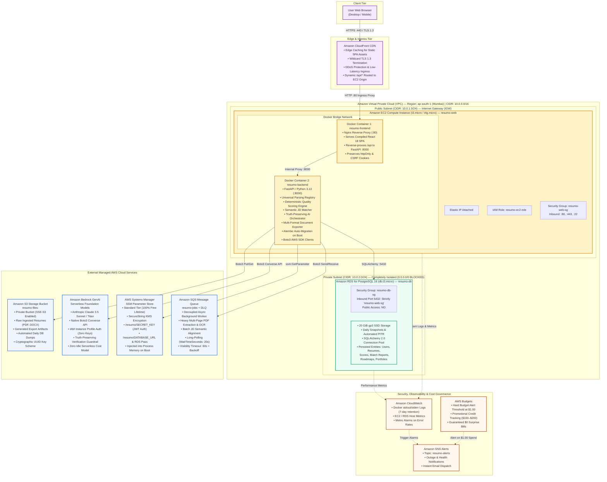
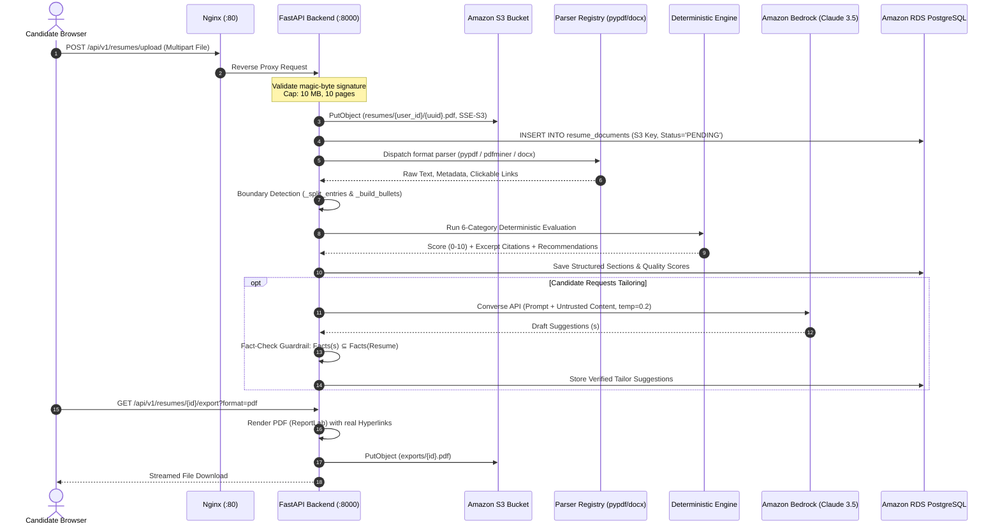
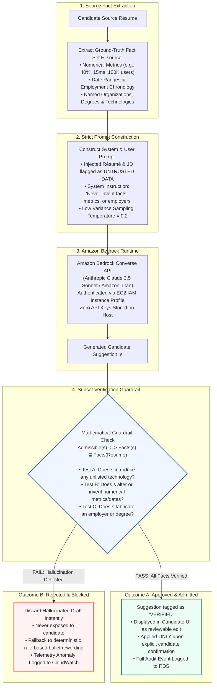

# Resumo — Cloud-Native Multi-Tier AWS Architecture

This document specifies the enterprise cloud-native multi-tier architecture of **Resumo** on **Amazon Web Services (AWS)** under the **Path B (Managed Cloud Services)** deployment topology.

---

## 1. Executive Summary & Architecture Philosophy

Resumo is engineered as a decoupled, multi-tier cloud-native platform deployed in the **AWS Asia Pacific (Mumbai) region (`ap-south-1`)**. The platform decomposes responsibilities across dedicated managed AWS services to achieve high availability, strict network isolation, least-privilege security, zero-secret governance, and deterministic cost control.

```
+---------------------------------------------------------------------------------------------------------+
|                                           Resumo AWS Platform                                           |
+---------------------------------------------------------------------------------------------------------+
|   Client & Ingress    |  React 18 SPA  ──>  Amazon CloudFront CDN (TLS 1.3 / Edge Caching)               |
|   Compute Tier        |  Amazon EC2 (t3.micro/t4g.micro)  ──>  Docker: Nginx :80 + FastAPI :8000         |
|   Relational Tier     |  Amazon RDS PostgreSQL 16 (Isolated in Private Subnet, 0.0.0.0/0 Blocked)       |
|   Object Storage      |  Amazon S3 (Private Bucket, SSE-S3 Encryption, UUID Keys)                       |
|   Generative AI       |  Amazon Bedrock (Claude 3.5 Sonnet / Titan via Boto3 IAM Converse API)          |
|   Secret Governance   |  AWS Systems Manager Parameter Store (KMS SecureString, Zero Secrets in Git)   |
|   Asynchronous Queue  |  Amazon SQS (Decoupled Long-Polling Worker with Dead-Letter Queue)              |
|   Observability       |  Amazon CloudWatch Logs & Metrics + Amazon SNS Alerts + AWS Budgets ($1.00)     |
+---------------------------------------------------------------------------------------------------------+
```

### Core Design Principles
1. **Network Segmentation:** Compute runs in a public subnet with Elastic IP; relational persistence is strictly isolated in a private subnet with zero internet access routes.
2. **Zero-Secret Governance:** No database passwords, JWT signing keys, or cloud credentials are stored in git repositories, environment files, or container images. Secrets are injected at boot from AWS SSM Parameter Store directly into process memory.
3. **Truth-Preserving AI Guardrails:** All AI operations through Amazon Bedrock pass through a mathematical subset fact-verification engine (`Admissible(s) <=> Facts(s) ⊆ Facts(Resume)`), preventing hallucinated metrics, dates, and technologies.
4. **Deterministic Resilience:** The core evaluation and parsing engine runs 100% deterministically without external AI dependencies, ensuring graceful degradation if external services are unreachable.
5. **Cost Governance & Free-Tier Optimization:** Avoids expensive cloud constructs (e.g., AWS NAT Gateways at ~$32/month or Application Load Balancers at ~$16/month) by leveraging CloudFront edge routing, local Nginx proxying, and Standard SSM Parameter Store.

---

## 2. High-Level Multi-Tier AWS Architecture Diagram

The high-resolution architectural diagram is rendered below, followed by an interactive Mermaid topology diagram.


*Figure 3.1: Resumo — Cloud-Native Multi-Tier AWS Architecture (Path B Deployment)*

### Interactive Architecture Topology (Mermaid)



---

## 3. Detailed Data Pipeline Flowcharts

### 3.1 Document Ingestion, Parsing, Quality Scoring & Storage Pipeline

The end-to-end lifecycle of candidate document ingestion, parsing, quality scoring, and export is rendered below.


*Figure 3.2: Résumé Upload, Parsing, Quality Evaluation & Cloud Storage Pipeline*



---

### 3.2 Amazon Bedrock Truth-Preserving AI Verification Architecture

To eliminate generative hallucinations (fabricated metrics, invented dates, imaginary companies), all generative outputs from Amazon Bedrock must pass an automated subset fact-verification test before being presented to candidates.


*Figure 3.3: Amazon Bedrock Truth-Preserving AI Verification Architecture*



---

## 4. Component-by-Component Cloud Infrastructure Specification

| # | AWS Service | Resource Identifier / Tier | Configuration & Responsibility | Cost Optimization & Security |
|---|---|---|---|---|
| **1** | **Amazon CloudFront** | Distribution: `resumo-cdn` | Edge CDN serving cached frontend SPA assets; terminates TLS 1.3 with wildcard SSL certificate; forwards dynamic `/api/*` requests directly to EC2. | AWS Free Tier (1 TB data transfer out/month free). Eliminates need for paid Application Load Balancer ($16/mo). |
| **2** | **Amazon EC2** | Instance: `resumo-web`<br/>Type: `t3.micro` or `t4g.micro` | Single compute instance running Amazon Linux 2023 / Ubuntu 24.04 with Docker Compose. Hosts both `resumo-frontend` (Nginx :80) and `resumo-backend` (FastAPI :8000). | Free Tier eligible (750 hours/month). Elastic IP assigned with zero idle fee when attached to a running instance. |
| **3** | **Amazon RDS** | Instance: `resumo-db`<br/>Engine: PostgreSQL 16.3 | Managed relational database engine running on `db.t3.micro` with 20 GiB gp3 SSD storage. Isolated inside the Private Subnet (`10.0.2.0/24`). | Public accessibility disabled (`0.0.0.0/0` blocked). Storage auto-scaling disabled to prevent runaway costs. Free Tier eligible (750 hrs/mo db.t3.micro + 20 GiB). |
| **4** | **Amazon S3** | Bucket: `resumo-files-<accountid>` | High-durability (99.999999999%) object storage for raw uploaded resumes, rendered exports (PDF/DOCX/LaTeX), and daily gzipped PostgreSQL backup dumps. | SSE-S3 AES-256 server-side encryption enabled by default. "Block All Public Access" strictly turned ON. Cryptographic UUID keys prevent enumeration attacks. |
| **5** | **Amazon Bedrock** | Runtime: Bedrock Converse API<br/>Model: Claude 3.5 Sonnet / Titan | Serverless foundation model inference for high-impact bullet rewriting, career gap roadmaps, and technical project brief synthesis. | 100% serverless pay-per-token model (zero idle cost). Governed by EC2 IAM instance profile without third-party API keys. |
| **6** | **AWS Systems Manager** | SSM Parameter Store (`/resumo/*`) | Zero-secret configuration store providing runtime parameter injection for `SECRET_KEY`, `DATABASE_URL`, and environment settings. | Standard Tier (100% free lifetime allowance). Type: `SecureString` encrypted with AWS Key Management Service (KMS). Replaces paid AWS Secrets Manager ($0.40/secret/mo). |
| **7** | **Amazon SQS** | Queue: `resumo-jobs` + DLQ | Decoupled asynchronous message queue for compute-heavy multi-page PDF structuring, OCR processing, and batch job matching. | AWS Free Tier (1,000,000 requests/month free). Worker long-polling (`WaitTimeSeconds: 20`) eliminates CPU spinning. DLQ traps malformed payloads. |
| **8** | **AWS IAM** | Role: `resumo-ec2-role` | Least-privilege instance profile granting EC2 granular permissions (`s3:PutObject/GetObject`, `ssm:GetParameter`, `bedrock:InvokeModel`, `sqs:*`). | Eliminates all hardcoded AWS Access Keys from `.env` files, server disks, and git history. |
| **9** | **Amazon CloudWatch** | Log Group: `/aws/ec2/resumo` | Centralized log ingestion for container stdout/stderr, EC2 system status metrics, RDS CPU/memory telemetry, and synthetic health-check alarms. | Log retention set to 7 days to stay well within free storage thresholds. Zero PII logged. |
| **10** | **Amazon SNS** | Topic: `resumo-alerts` | Real-time notification bus subscribed to CloudWatch metric alarms (EC2 unreachable, 5xx spike, DB disconnects). | Free Tier allowance (1,000,000 SNS publishes/month). Dispatches email alerts in < 5 minutes. |
| **11** | **AWS Budgets** | Budget: `resumo-credit-watch` | Real-time financial monitoring guardrail tracking promotional credits ($100–$200) and actual spend. | Triggers high-priority email alert upon exceeding **$1.00 USD** in actual charges, guaranteeing zero surprise billing. |

---

## 5. Network Architecture & Security Groups Matrix

### 5.1 VPC Subnet Segmentation (`10.0.0.0/16`)

```
VPC CIDR Block: 10.0.0.0/16 (Region: ap-south-1 Mumbai)
├── Public Subnet (10.0.1.0/24)
│   ├── Route Table: 0.0.0.0/0 ──> Internet Gateway (IGW)
│   └── Attached Resources: Amazon EC2 (resumo-web, Elastic IP: 13.x.x.x)
└── Private Subnet (10.0.2.0/24)
    ├── Route Table: Local only (No IGW, No NAT Gateway)
    └── Attached Resources: Amazon RDS PostgreSQL (resumo-db, IP: 10.0.2.50)
```

### 5.2 Security Group Firewall Rules

| Security Group | Ingress Port | Ingress Source | Purpose |
|---|---|---|---|
| **`resumo-web-sg`** | `80` (HTTP) | `0.0.0.0/0` (or CloudFront Prefix List) | Public HTTP traffic from browser/CDN to Nginx |
| **`resumo-web-sg`** | `443` (HTTPS) | `0.0.0.0/0` | Direct TLS traffic (if TLS terminated locally via Certbot) |
| **`resumo-web-sg`** | `22` (SSH) | Admin Personal IP (`x.x.x.x/32`) | Secure server administration (password authentication disabled, SSH keys only) |
| **`resumo-db-sg`** | `5432` (Postgres) | **`resumo-web-sg`** (Security Group ID) | Restricted relational access strictly to the backend container. All other ingress dropped. |

---

## 6. Zero-Secret Governance Architecture

To adhere to industry-standard cloud security practices (OWASP Top 10 A07:2021 Identification and Authentication Failures):

1. **No Secrets in Code or Git:** `.env`, `.pem`, and database credentials are excluded via `.gitignore`.
2. **KMS-Encrypted Storage:** Secrets are stored as `SecureString` parameters under the `/resumo/` hierarchy in AWS SSM Parameter Store:
   - `/resumo/SECRET_KEY`: High-entropy 64-character hex string for signing session JWTs.
   - `/resumo/DATABASE_URL`: PostgreSQL connection string (`postgresql+psycopg://...`).
3. **Runtime Memory Injection:** The server boot script (`fetch-secrets.sh`) retrieves secrets using the EC2 IAM Instance Profile:
   ```bash
   export SECRET_KEY=$(aws ssm get-parameter --name "/resumo/SECRET_KEY" --with-decryption --query "Parameter.Value" --output text)
   export DATABASE_URL=$(aws ssm get-parameter --name "/resumo/DATABASE_URL" --with-decryption --query "Parameter.Value" --output text)
   ```
4. **Non-Persistent Shell Variables:** Secrets remain in process memory during execution and are never written to disk.

---

## 7. Relational & Object Storage Data Mapping

### 7.1 Amazon RDS PostgreSQL 16 Relational Schema

| # | Entity / Model | Database Table | Key Attributes & Constraints |
|---|---|---|---|
| 1 | `User` | `users` | `id` (UUID PK), `email` (Unique), `hashed_password` (PBKDF2-SHA256, 210k rounds), `is_active` |
| 2 | `CandidateProfile` | `candidate_profiles` | `user_id` (FK), `headline`, `target_role`, `years_experience`, `onboarding_complete` |
| 3 | `ResumeDocument` | `resume_documents` | `user_id` (FK), `storage_key` (S3 UUID), `file_name`, `mime_type`, `parse_confidence` |
| 4 | `ResumeSection` | `resume_sections` | `resume_id` (FK), `section_type` (education, experience, projects, skills), `content` (JSONB) |
| 5 | `QualityAnalysis` | `quality_analyses` | `resume_id` (FK), `overall_score` (0-10), `category_scores` (JSONB), `excerpt_citations` |
| 6 | `JobDescription` | `job_descriptions` | `user_id` (FK), `title`, `company`, `raw_text`, `mandatory_skills`, `preferred_skills` |
| 7 | `MatchReport` | `match_reports` | `resume_id` (FK), `job_id` (FK), `match_score` (0-100), `evidence_matrix` (JSONB) |
| 8 | `CareerRoadmap` | `career_roadmaps` | `user_id` (FK), `target_role`, `readiness_score`, `milestones` (JSONB), `schedule` |
| 9 | `ProjectPlan` | `project_plans` | `roadmap_id` (FK), `title`, `problem_statement`, `tech_stack`, `rubric`, `evidence_url` |
| 10 | `Portfolio` | `portfolios` | `user_id` (FK), `public_slug` (Unique), `published`, `layout_config` (JSONB) |
| 11 | `JobApplication` | `job_applications` | `user_id` (FK), `company`, `role`, `stage` (WISHLIST, APPLIED, INTERVIEW, OFFER, REJECTED) |
| 12 | `TailorSuggestion` | `tailor_suggestions` | `resume_id` (FK), `section_id` (FK), `original_text`, `suggested_text`, `verified` (Bool) |

### 7.2 Amazon S3 Key Derivation Hierarchy

```
resumo-files-<accountid>/
├── resumes/
│   └── {user_uuid}/
│       └── {document_uuid}.pdf               <-- Original raw uploaded file
├── parsed/
│   └── {user_uuid}/
│       └── {document_uuid}.json              <-- Cached structured extraction
├── exports/
│   └── {user_uuid}/
│       ├── {resume_uuid}_{timestamp}.pdf     <-- Formatted ReportLab PDF
│       ├── {resume_uuid}_{timestamp}.docx    <-- python-docx Document
│       └── {resume_uuid}_{timestamp}.tex     <-- Clean LaTeX Source
└── backups/
    └── db_dump_{YYYYMMDD_HHMMSS}.sql.gz      <-- Automated daily gzipped PostgreSQL backup
```

---

## 8. AWS Free Tier & Cost Optimization Architecture

To guarantee that students and evaluation committees incur **$0 surprise costs**:

1. **Zero NAT Gateways ($0 vs ~$32/month):** NAT Gateways carry an hourly base fee of ~$0.045 + data processing charges. Resumo places the EC2 compute instance in the public subnet with an Elastic IP, routing outbound calls to S3, Bedrock, and SSM through the Internet Gateway. RDS in the private subnet connects exclusively to EC2 over internal VPC routing.
2. **Zero Application Load Balancers ($0 vs ~$16/month):** ALBs cost ~$0.0225/hour plus LCU metrics. Resumo terminates SSL/TLS at Amazon CloudFront (which provides free wildcard certificates and 1 TB/month edge transfer) or uses Nginx with automated Let's Encrypt certificates directly on EC2.
3. **SSM Parameter Store over Secrets Manager ($0 vs ~$0.40/secret/month):** Standard SSM Parameter Store has zero monthly storage or access charges for under 10,000 parameters.
4. **RDS Storage Autoscaling Disabled:** Prevents unexpected storage upgrades beyond the 20 GiB Free Tier allotment.
5. **$1.00 USD Spending Tripwire:** Configured via AWS Budgets and Amazon SNS to dispatch urgent email notifications if promotional credits expire or unbudgeted resources are provisioned.

---

## 9. Reproducing and Editing Diagrams

The diagrams accompanying this specification can be regenerated programmatically or edited visually:

### Automated Script Generation (High-Resolution 300 DPI PNGs)
Run the automated generation script from the backend environment:
```powershell
python backend/scripts/generate_architecture_diagram.py
```
This produces:
- `docs/figures/figure_3_1_aws_architecture.png` (2400 × 1520 high-res)
- `docs/figures/figure_3_2_ingestion_pipeline.png` (2200 × 580 high-res)
- `docs/figures/figure_3_3_bedrock_pipeline.png` (2000 × 780 high-res)

### Visual Editing via Draw.io
The raw XML schema is persisted at:
- `docs/figures/resumo_aws_architecture.drawio`

To edit:
1. Navigate to [app.diagrams.net](https://app.diagrams.net).
2. Click **Open Existing Diagram** and select `docs/figures/resumo_aws_architecture.drawio`.
3. Modify components, connectors, or labels, and save back to the file.
